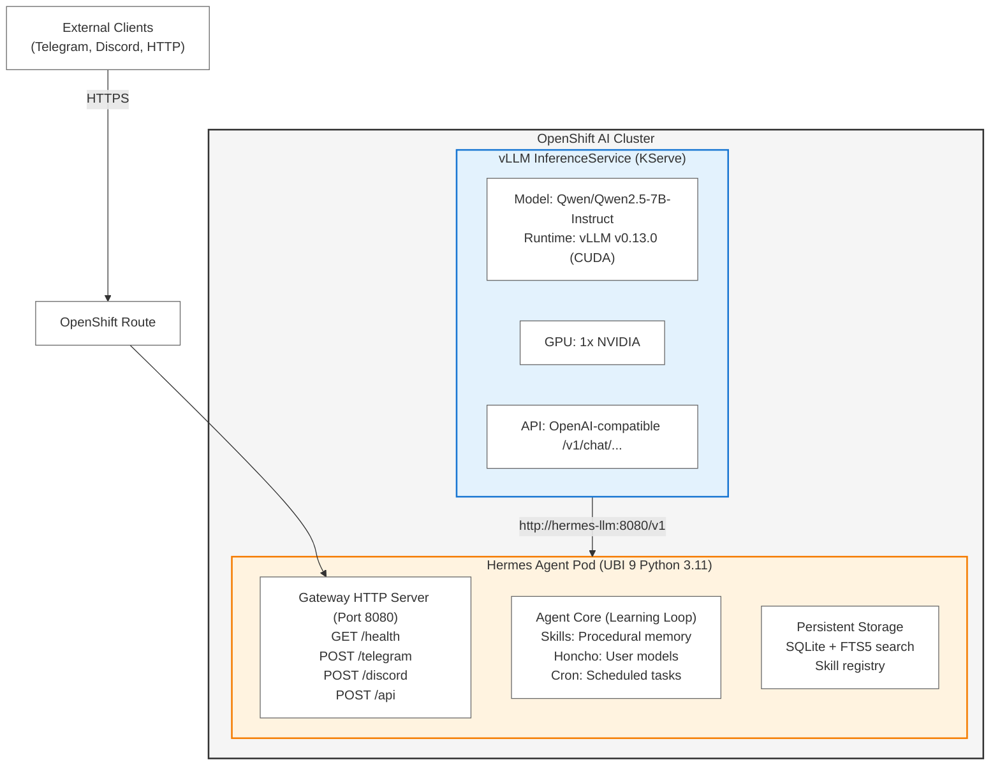

# Hermes Agent on Red Hat OpenShift AI

Deploy [Hermes Agent](https://github.com/NousResearch/hermes-agent), the self-improving AI agent with a built-in learning loop, on Red Hat OpenShift AI connected to GPU-accelerated vLLM model serving.

> **Choose a deployment path:**
>
> | Your cluster | Use |
> |---|---|
> | OpenShift AI with Models-as-a-Service, managed by RHACM and AutoShift | The AutoShift `hermes-agent` and `open-webui` policies. See [`autoshift/README.md`](autoshift/README.md) |
> | Any OpenShift 4 cluster, with any OpenAI-compatible LLM | One script deploys Hermes plus Open WebUI. See [`deploy/README.md`](deploy/README.md) |
>
> [`gitops/`](gitops/README.md) keeps `gitops/base`, which `deploy/` builds on, and the findings
> from the earlier Argo CD path for Models-as-a-Service, which has been removed. The sections below describe
> the original vLLM deployment from the Red Hat Developer article.

**What this provides:**
- UBI 9-based container image with full Hermes Agent stack
- Gateway for multi-platform messaging (Telegram, Discord, Slack, WhatsApp, Signal)
- Direct integration with vLLM InferenceService on OpenShift AI
- Kubernetes health probes and lifecycle management
- OpenShift Security Context Constraint compliance (`restricted-v2`)
- Complete deployment manifests with vLLM setup

**Architecture:**



The deployment consists of:
- **vLLM InferenceService (KServe):** GPU-accelerated model serving with OpenAI-compatible API
- **Hermes Agent Pod:** UBI 9 container with gateway, agent core, and persistent storage
- **Gateway HTTP Server:** Multi-platform messaging endpoints (Telegram, Discord, HTTP API)
- **Agent Core:** Learning loop with skills system, Honcho user modeling, and cron scheduler
- **PersistentVolumeClaim (10Gi):** Durable storage for skills, memories, and user models

## Quick Start

### Prerequisites

- Red Hat OpenShift 4.x cluster with OpenShift AI
- `oc` CLI authenticated to cluster
- GPU node for vLLM model serving (optional but recommended)
- 10Gi available storage

### Deploy

```bash
# Clone repository
git clone https://github.com/aicatalyst-team/hermes-openshift
cd hermes-openshift

# Deploy vLLM model serving + Hermes Agent
oc apply -k manifests/

# Wait for pods to be ready
oc get pods -n hermes -w

# Check vLLM model serving
oc get inferenceservice -n hermes

# Test Hermes gateway
oc run test-hermes --rm -i --image=curlimages/curl -- \
  curl -s http://hermes-agent.hermes.svc.cluster.local:8080/health
```

Expected output:
```json
{"status":"healthy","gateway":"running"}
```

### Access Hermes Agent

**From within cluster:**
```
http://hermes-agent.hermes.svc.cluster.local:8080
```

**From external (if Route is deployed):**
```
https://hermes-agent-hermes.apps.your-cluster.com
```

## What's Inside

### Manifests

- **`01-namespace.yaml`** - Creates `hermes` namespace
- **`02-vllm-storage.yaml`** - 50Gi PVC for vLLM model weights
- **`03-vllm-servingruntime.yaml`** - KServe vLLM runtime with CUDA support
- **`04-vllm-inferenceservice.yaml`** - Deploys Qwen2.5-3B-Instruct model
- **`05-hermes-storage.yaml`** - 10Gi PVC for Hermes Agent data
- **`06-hermes-config.yaml`** - ConfigMap with vLLM endpoint configuration
- **`07-hermes-deployment.yaml`** - Hermes Agent deployment with health probes
- **`08-hermes-service.yaml`** - ClusterIP service on port 8080
- **`09-hermes-route.yaml`** - (Optional) OpenShift Route with TLS

### Container Image

Pre-built image: `quay.io/aicatalyst/hermes-agent:latest`

Built from `Dockerfile.ubi` (UBI 9 Python 3.11) with:
- Hermes Agent 0.12.x + all messaging dependencies
- Node.js 20.x for web UI and TUI
- Python virtualenv with `.[all,messaging]` extras
- OpenShift arbitrary UID support

### Gateway Service

`hermes gateway` command - Runs HTTP gateway for multi-platform messaging with webhook endpoints for:
- Telegram (`POST /telegram`)
- Discord (`POST /discord`)
- Slack (`POST /slack`)
- HTTP API (`POST /api`)
- Health check (`GET /health`)

## Usage Examples

### CLI Access (Interactive Terminal)

```bash
# Get shell in Hermes pod
POD=$(oc get pods -n hermes -l app=hermes-agent -o jsonpath='{.items[0].metadata.name}')
oc exec -it $POD -n hermes -- /opt/hermes/venv/bin/python -m hermes_cli.main

# Or use hermes command directly
oc exec -it $POD -n hermes -- hermes

# Start a conversation
> Hello! Can you help me analyze this cluster?
```

### Gateway API (HTTP)

```python
import requests

# Send message to Hermes via HTTP API
url = "http://hermes-agent.hermes.svc.cluster.local:8080/api"
response = requests.post(url, json={
    "message": "What OpenShift resources are available?",
    "user_id": "test-user",
    "platform": "api"
})

print(response.json())
```

### Telegram Integration

```bash
# Create secret with Telegram bot token
oc create secret generic telegram-token \
  --from-literal=TELEGRAM_BOT_TOKEN=your-bot-token-here \
  -n hermes

# Update deployment to use secret
oc set env deployment/hermes-agent \
  --from=secret/telegram-token \
  -n hermes

# Get webhook URL (if Route is deployed)
WEBHOOK_URL=$(oc get route hermes-agent -n hermes -o jsonpath='{.spec.host}')
echo "Set Telegram webhook to: https://$WEBHOOK_URL/telegram"
```

## Customization

### Change vLLM Model

Edit `manifests/04-vllm-inferenceservice.yaml`:
```yaml
spec:
  predictor:
    model:
      modelFormat:
        name: vLLM
      storageUri: "hf://NousResearch/Hermes-3-Llama-3.1-8B"  # Change model
```

Supported models:
- `Qwen/Qwen2.5-3B-Instruct` - Fast, lightweight (default)
- `NousResearch/Hermes-3-Llama-3.1-8B` - Hermes-tuned Llama 3.1
- `meta-llama/Meta-Llama-3.1-8B-Instruct` - Meta's Llama 3.1
- Any Hugging Face model compatible with vLLM

### Change Storage Size

Edit `manifests/05-hermes-storage.yaml`:
```yaml
resources:
  requests:
    storage: 50Gi  # Increase for more conversation history
```

### Enable External Access

Deploy the Route:
```bash
oc apply -f manifests/09-hermes-route.yaml
```

Get external URL:
```bash
oc get route hermes-agent -n hermes -o jsonpath='{.spec.host}'
```

### Add Messaging Platform Credentials

```bash
# Telegram
oc create secret generic hermes-secrets \
  --from-literal=TELEGRAM_BOT_TOKEN=your-token \
  -n hermes

# Discord
oc create secret generic hermes-secrets \
  --from-literal=DISCORD_BOT_TOKEN=your-token \
  --dry-run=client -o yaml | oc apply -f -

# Update deployment to use secrets
oc set env deployment/hermes-agent \
  --from=secret/hermes-secrets \
  -n hermes
```

### Build Custom Image

```bash
# Build locally
git clone https://github.com/NousResearch/hermes-agent
cd hermes-agent
podman build -f Dockerfile.ubi -t quay.io/your-org/hermes-agent:latest --platform linux/amd64 .

# Push to registry
podman push quay.io/your-org/hermes-agent:latest

# Update manifest
# Edit manifests/07-hermes-deployment.yaml and change image: line
```

## Architecture Details

### Why vLLM on OpenShift AI?

| Aspect | Local LLM | vLLM on OpenShift AI |
|--------|-----------|---------------------|
| Deployment | Single machine | Kubernetes cluster |
| GPU sharing | Not supported | Multi-tenant GPU scheduling |
| Autoscaling | Manual | KServe autoscaling |
| Model serving | Custom code | OpenAI-compatible API |
| Monitoring | Ad-hoc | Prometheus/Grafana built-in |
| High availability | Single point of failure | Kubernetes resilience |

### OpenShift Security

Runs under `restricted-v2` SCC:
- `runAsNonRoot: true`
- `allowPrivilegeEscalation: false`
- All capabilities dropped
- `seccompProfile: RuntimeDefault`

Container runs with arbitrary UID (OpenShift assigns random UID in range 1000000000-2147483647) but always GID 0 (root group).

### Hermes Learning Loop

1. **Conversation** - User interacts via Telegram/Discord/CLI
2. **Tool execution** - Agent calls tools (bash, file operations, HTTP)
3. **Memory persistence** - Honcho stores user model, preferences, context
4. **Skill creation** - Agent extracts reusable patterns as skills
5. **Skill improvement** - Skills self-improve during use
6. **Session search** - FTS5 search across past conversations
7. **Scheduled tasks** - Cron jobs deliver results to any platform

### Node.js 20.x on UBI 9

UBI 9 ships with Node.js 16.x, but Hermes requires 20.x for Vite.

**Solution:** Install from NodeSource RPM repository:
```dockerfile
RUN curl -fsSL https://rpm.nodesource.com/setup_20.x | bash - \
    && dnf install -y nodejs
```

## Troubleshooting

### Pod in CrashLoopBackOff

Check logs:
```bash
POD=$(oc get pods -n hermes -l app=hermes-agent -o jsonpath='{.items[0].metadata.name}')
oc logs $POD -n hermes
```

Common issues:
- vLLM endpoint not accessible (check InferenceService is ready)
- PVC not bound (check storage class and node affinity)
- Missing messaging platform credentials (non-blocking if using GATEWAY_ALLOW_ALL_USERS=true)

### vLLM InferenceService Not Ready

```bash
oc get inferenceservice -n hermes
oc describe inferenceservice hermes-llm -n hermes
```

Common issues:
- No GPU nodes available
- Model download failed (check storage PVC is bound)
- Wrong `modelFormat.name` (must be uppercase `vLLM`)

### ImagePullBackOff

If using private registry:
```bash
oc create secret docker-registry quay-pull \
  --docker-server=quay.io \
  --docker-username=YOUR-USERNAME \
  --docker-password=YOUR-PASSWORD \
  -n hermes

oc secrets link default quay-pull --for=pull -n hermes
```

### Health Probe Failures

Check gateway is running:
```bash
oc run test-health --rm -i --image=curlimages/curl -- \
  curl -v http://hermes-agent.hermes.svc.cluster.local:8080/health
```

Should return `{"status":"healthy","gateway":"running"}`.

## Development

### Local Testing

```bash
# Install with all dependencies
cd /path/to/hermes-agent
pip install -e ".[all,messaging,dev]"

# Set vLLM endpoint
export OPENAI_BASE_URL=http://localhost:8080/v1
export LLM_MODEL=hermes-llm

# Run gateway
hermes gateway

# Test
curl http://localhost:8080/health
```

### WebSocket Testing (for real-time messaging)

```bash
cd examples
python3 test-gateway.py
```

## Contributing

This repository contains the UBI 9 Dockerfile and OpenShift deployment manifests for Hermes Agent.

**Components:**
- **UBI 9 Dockerfile** - Enterprise-ready container image
- **OpenShift manifests** - Kustomize-based deployment with vLLM
- **vLLM configuration** - KServe InferenceService setup

## Resources

- **Hermes Agent GitHub:** https://github.com/NousResearch/hermes-agent
- **Documentation:** https://hermes-agent.nousresearch.com/docs/
- **Skills Hub:** https://agentskills.io
- **Red Hat OpenShift AI:** https://www.redhat.com/en/technologies/cloud-computing/openshift/openshift-ai
- **KServe:** https://kserve.github.io/website/
- **vLLM:** https://docs.vllm.ai/

## License

- **Hermes Agent:** MIT License
- **UBI Dockerfile and deployment manifests:** Apache 2.0 License

---

**Maintained by:** [Red Hat AI Catalyst Team](https://github.com/aicatalyst-team)
